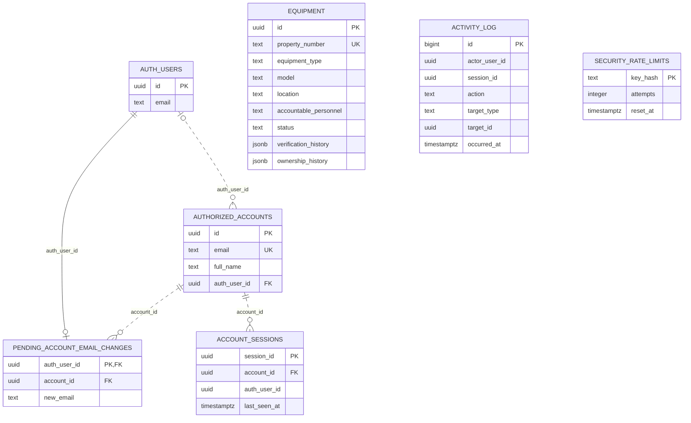

# ICT Inventory ERD

This diagram shows the main columns in the current Supabase schema. `AUTH_USERS` is Supabase's `auth.users` table; the other entities are in the `public` schema.

Lines show declared foreign keys; the solid line is identifying because `pending_account_email_changes.auth_user_id` is also its primary key. The `activity_log` columns `actor_user_id`, `session_id`, and `target_id` are logical references without foreign-key constraints. `target_id` refers to equipment only when `target_type = 'equipment'`. `security_rate_limits` is standalone. Equipment verification and ownership histories are stored as JSONB in `equipment`, rather than in separate tables.

Source: [`lib/supabase/schema.sql`](lib/supabase/schema.sql).
